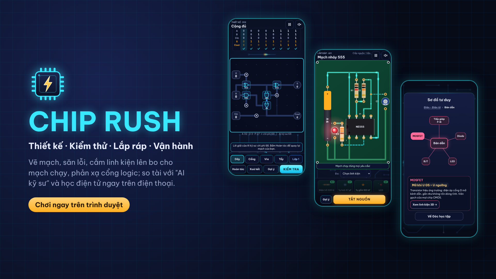
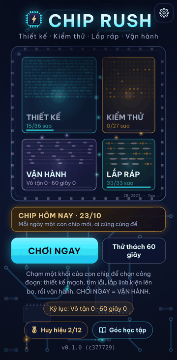
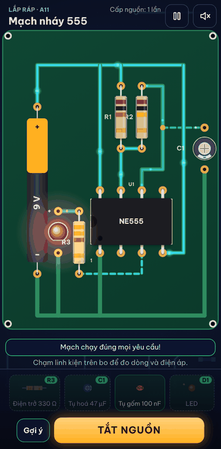
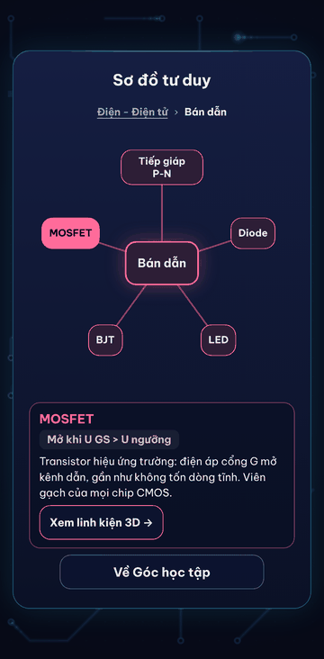
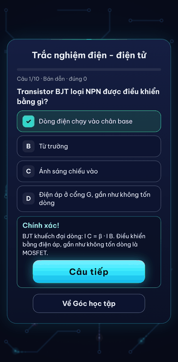
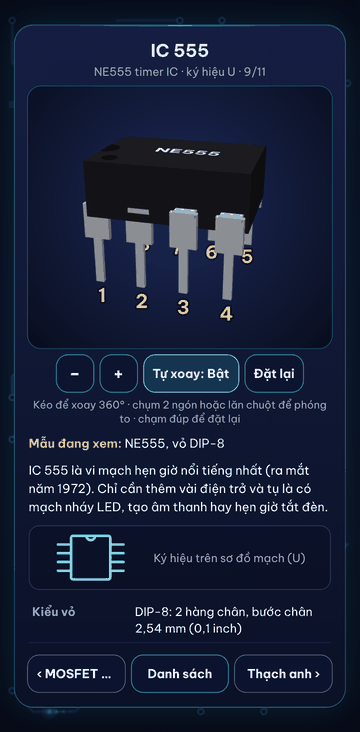
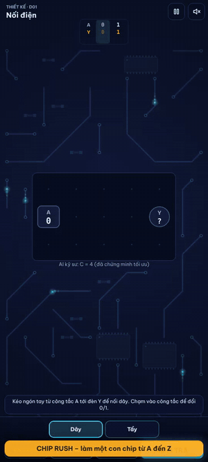

# CHIP RUSH

**Hành trình của một con chip, chơi ngay trên điện thoại.** Thiết kế mạch bằng cổng logic, tìm lỗi chip vừa sản xuất, lắp linh kiện lên bo mạch cho mạch chạy, rồi vận hành trong chế độ arcade. Kèm một **Góc học tập** về điện - điện tử: sơ đồ tư duy, trắc nghiệm và thư viện linh kiện 3D.

Dự thi **Phần thi Công nghệ, Road to Predator League 2027**.



<p align="center">
  <a href="https://lehngvu0110-pixel.github.io/chip-rush/"><b>Chơi ngay</b></a> ·
  <a href="docs/submission/demo.mp4">Video demo 45 giây</a> ·
  <a href="docs/SPEC.md">Luật chơi chi tiết</a> ·
  <a href="docs/ai-log/">Nhật ký dùng AI</a>
</p>

> **Trạng thái:** đủ 4 chế độ (12 màn THIẾT KẾ, 9 màn KIỂM THỬ, 11 màn LẮP RÁP, VẬN HÀNH Vô tận + 60 giây), Chip hôm nay, 12 huy hiệu và Góc học tập. Đang đo hiệu năng trên máy thật trước khi nộp ngày 26/10/2026.

## Mục lục
- [Ảnh trong game](#ảnh-trong-game)
- [Tính năng](#tính-năng)
- [Cách chơi](#cách-chơi)
- [AI trong game và trong quá trình làm game](#ai-trong-game-và-trong-quá-trình-làm-game)
- [Kỹ thuật](#kỹ-thuật)
- [Chạy trên máy](#chạy-trên-máy)
- [Kiểm thử](#kiểm-thử)
- [Tài liệu](#tài-liệu)
- [Khả năng truy cập và quyền riêng tư](#khả-năng-truy-cập-và-quyền-riêng-tư)
- [Tác giả và giấy phép](#tác-giả-và-giấy-phép)

## Ảnh trong game
| Màn chính | LẮP RÁP | Sơ đồ tư duy | Trắc nghiệm | Linh kiện 3D |
| :---: | :---: | :---: | :---: | :---: |
|  |  |  |  |  |

<p align="center"></p>

## Tính năng

### Bốn công đoạn của một con chip
Màn chính là một con chip nhìn từ trên xuống, chia 4 khối chạy vòng theo chiều kim đồng hồ. Chạm khối nào là vào công đoạn đó.

| Chế độ | Cách chơi | Số màn | Học được gì |
| --- | --- | --- | --- |
| **THIẾT KẾ** | Kéo ngón tay vẽ dây, đặt cổng logic, làm đèn sáng đúng bảng chân trị; chấm theo chi phí PPA so với AI kỹ sư | 12 | Đi dây, bảng chân trị, via 2 lớp, bộ cộng, PPA |
| **KIỂM THỬ** | Chip vừa sản xuất có 1 lỗi ẩn; đo các điểm trên mạch để tìm ra, càng ít lần đo càng nhiều sao | 9 | Đo kiểm (probing), mô hình lỗi stuck-at và đảo cổng, lớp lỗi tương đương |
| **LẮP RÁP** | Cắm linh kiện từ khay lên bo mạch, xoay đúng chiều, bấm CẤP NGUỒN; mạch chạy bằng mô phỏng thật | 11 | Định luật Ohm, mã màu điện trở, cực LED/diode/tụ hoá, AND/OR bằng công tắc, BJT, MOSFET, cổng NOT, hằng số RC, IC 555 |
| **VẬN HÀNH** | Arcade phản xạ: chọn cổng AND/OR/XOR/NAND trước khi gói bit chạm ổ cắm; Vô tận hoặc Thử thách 60 giây | Vô tận | Cổng logic |

Trong LẮP RÁP, linh kiện quá tải sẽ bốc khói. Khi có điện, bạn có thể ấn giữ nút nhấn ngay trên bo, hoặc chạm một linh kiện để đo dòng và điện áp như dùng đồng hồ vạn năng.

### Góc học tập
| Phần | Nội dung |
| --- | --- |
| **Sơ đồ tư duy** | 6 nhánh, 29 ý chính: đại lượng cơ bản, định luật (Ohm, Kirchhoff), linh kiện thụ động, bán dẫn, mạch số, vi mạch. Chạm nhánh để mở, chạm ý để đọc giải thích và công thức. Nhiều ý có nút đi thẳng tới linh kiện 3D hoặc màn chơi dùng đúng kiến thức đó. |
| **Trắc nghiệm** | Mỗi lượt 10 câu theo 4 chủ đề (hoặc trộn tất cả). Gồm 32 câu lý thuyết và 7 dạng câu tính toán đổi số mỗi lần: Ohm, công suất, điện trở hạn dòng cho LED, nối tiếp/song song, đọc vạch màu, nhị phân, cổng logic. Mỗi câu có lời giải; cuối lượt xem lại câu sai, lưu kỷ lục. |
| **Linh kiện 3D** | 11 linh kiện (điện trở, tụ gốm, tụ hoá, cuộn cảm, diode, LED, BJT, MOSFET, IC 555, thạch anh, nút nhấn), mô hình dựng bằng code, kéo xoay 360°, chụm 2 ngón hoặc lăn chuột để phóng to. Kèm ký hiệu sơ đồ, thông số mẫu, cách nhận biết chân và mục "Liên hệ với vi mạch". |

### Thêm
- **Chip hôm nay:** mỗi ngày (giờ Việt Nam) một đề THIẾT KẾ giống nhau cho mọi người, giữ chuỗi ngày.
- **12 huy hiệu** xuyên các chế độ, ví dụ "Hơn cả AI" khi thiết kế rẻ hơn AI kỹ sư.
- **Chia sẻ kết quả** thành ảnh 1080×1350 kèm lời mời (Web Share, hoặc sao chép khi trình duyệt không hỗ trợ).
- **Cài đặt:** âm thanh, giảm chuyển động, xoá tiến độ (bấm 2 lần để tránh lỡ tay).

## Cách chơi
- **Điện thoại (khuyên dùng, cầm dọc):** kéo ngón tay để vẽ dây; chạm để đặt cổng, đo dây, cắm linh kiện.
- **Máy tính:** dùng chuột như ngón tay, hoặc chơi hoàn toàn bằng bàn phím:

| Phím | Tác dụng |
| --- | --- |
| Mũi tên | Di chuyển ô viền trắng trên lưới THIẾT KẾ / KIỂM THỬ |
| Shift + mũi tên | Kéo dây |
| Space / Enter | Chạm vào ô; ở LẮP RÁP: ấn giữ nút nhấn khi có điện |
| Ctrl/⌘ + Z | Hoàn tác |
| 1-4 | Chọn cổng ở VẬN HÀNH |
| Mũi tên, + / −, 0 | Xoay, phóng to, đặt lại mô hình linh kiện 3D |
| Esc | Quay lại ở các bảng (danh sách màn, Góc học tập, Cài đặt...) |

Thêm `?debug=1` vào cuối link để hiện bảng đo hiệu năng (FPS, thời gian khung hình).

## AI trong game và trong quá trình làm game
**Trong game có "AI kỹ sư".** Đây là AI cổ điển (tìm kiếm và suy luận): không gọi API, không học từ dữ liệu người chơi, tính sẵn hoặc chạy ngay trên máy.

| Chế độ | Thuật toán | Kết quả kiểm chứng |
| --- | --- | --- |
| THIẾT KẾ (`src/ai/design-solver.ts`) | Đặt cổng bằng vét cạn/beam search, cắt nhánh **branch-and-bound** với cận dưới; đi dây bằng Dijkstra-Steiner và **PathFinder** (thuật toán đi dây FPGA) | Chứng minh tối ưu 7/12 màn; các màn còn lại người chơi có thể vượt AI |
| KIỂM THỬ (`src/ai/debug-solver.ts`) | Cây quyết định **minimax** trên tập lớp lỗi (bitmask + ghi nhớ) | Tối ưu ở cả 9 màn, đối chiếu bằng vét cạn mọi cây trong test |
| VẬN HÀNH (`src/ai/adaptive.ts`) | **Thompson sampling** (Beta-Bernoulli) ra thêm câu về cổng bạn hay sai, trộn 30% ngẫu nhiên | Thử thách 60 giây tắt AI để mọi người cùng đề |

**Minh bạch với người chơi:**
- Trang "AI kỹ sư hoạt động thế nào?" nêu thuật toán, số màn đã chứng minh tối ưu và giới hạn của từng cái.
- Sau mỗi màn KIỂM THỬ có nút "Xem AI kỹ sư đo" để phát lại từng bước suy luận.
- VẬN HÀNH báo ngay khi AI bắt đầu ra thêm câu về cổng bạn hay sai.

Giới hạn và cách kiểm chứng xem [`docs/SPEC.md` mục 5](docs/SPEC.md); quyết định thiết kế ở [ADR-0007](docs/adr/0007-solver-thiet-ke.md) và [ADR-0008](docs/adr/0008-kiem-thu-minimax.md).

**Trong quá trình làm game:** trợ lý AI (Claude) hỗ trợ lên kế hoạch, viết code và tài liệu. Mỗi yêu cầu và những gì đã kiểm tra được ghi công khai ở [`docs/ai-log/`](docs/ai-log/). Game không dùng ảnh hay âm thanh do AI tạo.

## Kỹ thuật
- **Không thư viện chạy trong game.** TypeScript thuần + Canvas 2D (lý do ở [ADR-0001](docs/adr/0001-canvas-thay-phaser.md)); Vite chỉ dùng để build.
- **Bộ mô phỏng mạch điện tự viết** (`src/core/assembly/circuit.ts`) cho LẮP RÁP:
  - phân tích điện áp nút, giải bằng khử Gauss;
  - mô hình tuyến tính từng đoạn cho diode, LED, BJT, MOSFET;
  - tụ điện theo thời gian (Euler lùi), IC 555 theo ngưỡng 1/3-2/3.
  - Bộ chấm chạy mọi trường hợp bấm nút như một bảng chân trị, đo tần số nháy và thời gian giữ sáng.
- **Bộ vẽ 3D mini trên Canvas 2D** (`src/render/mesh3d.ts`): chiếu phối cảnh, bỏ mặt sau, thuật toán hoạ sĩ, tô sáng Lambert; mô hình linh kiện dựng bằng code theo kích thước vỏ trong datasheet.
- **Hình vẽ bằng code, âm thanh tổng hợp bằng Web Audio**, font Be Vietnam Pro (OFL) đã subset tiếng Việt.
- **Ngân sách tải kiểm tra trong CI** (`tools/check-size.mjs`, tính sau gzip):

| Loại | Hiện tại | Giới hạn |
| --- | --- | --- |
| JavaScript | 96 KB | 120 KB |
| CSS | 6 KB | 15 KB |
| Font | 53 KB | 60 KB |
| Tổng lần tải đầu | 157 KB | 200 KB |

- **Máy yếu:** tự hạ đồ hoạ theo số đo khung hình (tắt hiệu ứng phát sáng, rồi giảm độ phân giải) để giữ mượt trên điện thoại tầm thấp.

<details>
<summary><b>Cấu trúc thư mục</b></summary>

```text
src/
  core/         logic thuần, chạy được trong Node (test bằng Vitest)
    circuit/    lưới 2 lớp, netlist, mô phỏng cổng logic (THIẾT KẾ, KIỂM THỬ)
    assembly/   bộ mô phỏng mạch điện, bo mạch, 11 màn LẮP RÁP
    learn/      sơ đồ tư duy, ngân hàng trắc nghiệm
    parts/      nội dung thư viện linh kiện, mã màu điện trở
    level/      màn THIẾT KẾ / KIỂM THỬ, Chip hôm nay, lời giải AI tính sẵn
  ai/           solver THIẾT KẾ, solver KIỂM THỬ, độ khó thích nghi
  modes/        scene từng chế độ (vẽ + nhận thao tác)
  render/       canvas, hiệu ứng, âm thanh, bộ vẽ 3D, mô hình linh kiện
  ui/           dựng DOM cho thẻ, bảng, Góc học tập
  platform/     lưu trữ an toàn, chia sẻ, xử lý lỗi
tests/          unit test (Vitest)
e2e/            test đầu-cuối + axe (Playwright)
tools/          giải màn offline, kiểm tra dung lượng, đo hiệu năng, ảnh nộp bài
docs/           đặc tả, kiến trúc, ADR, nhật ký AI, ảnh nộp bài
```
Chi tiết từng tầng và quy tắc phụ thuộc ở [docs/ARCHITECTURE.md](docs/ARCHITECTURE.md).
</details>

## Chạy trên máy
Cần Node.js 20 trở lên.
```bash
npm install
npm run dev        # mở http://localhost:5173 ; điện thoại cùng Wi-Fi mở http://<IP-máy>:5173
npm test           # unit test
npm run build      # build ra thư mục dist/
npm run ci         # typecheck + unit test + build + kiểm tra dung lượng
npx playwright install chromium webkit   # lần đầu
npm run e2e        # test đầu-cuối trên bản build (Android Chromium + iPhone WebKit)
```

## Kiểm thử
- **494 unit test** (Vitest), gồm:
  - luật chơi, solver AI;
  - bộ mô phỏng mạch so với kết quả tính tay (Ohm, β·Ib, nạp RC, tần số 555);
  - hình học bo mạch LẮP RÁP: đường đồng nối đúng lưới điện, lời giải chạy được, lỗi hay gặp bị chấm trượt;
  - đáp án câu trắc nghiệm tính toán khớp công thức.
- **43 test đầu-cuối** (Playwright) trên bản build: chơi trọn từng chế độ, chơi bằng bàn phím, nhiều cỡ màn hình, dữ liệu lưu hỏng, bộ nhớ đầy, chạm ngẫu nhiên.
- **axe-core (WCAG 2.1 AA): 0 lỗi** trên các màn chính.
- Thiết bị thật và số đo hiệu năng ghi ở [docs/TESTING.md](docs/TESTING.md).

## Tài liệu
| File | Nội dung |
| --- | --- |
| [docs/SPEC.md](docs/SPEC.md) | Luật chơi, công thức điểm, AI |
| [docs/GDD.md](docs/GDD.md) | Thiết kế trải nghiệm, hình ảnh, âm thanh |
| [docs/ARCHITECTURE.md](docs/ARCHITECTURE.md) | Kiến trúc code |
| [docs/adr/](docs/adr/) | Các quyết định kỹ thuật lớn |
| [docs/LEVELS.md](docs/LEVELS.md) | Danh sách màn chơi |
| [docs/TESTING.md](docs/TESTING.md) | Thiết bị, ma trận test, số đo hiệu năng |
| [docs/COMPLIANCE.md](docs/COMPLIANCE.md) | Đối chiếu điều lệ cuộc thi |
| [docs/ASSETS.md](docs/ASSETS.md) | Nguồn gốc và giấy phép mọi tài nguyên |
| [docs/DEVLOG.md](docs/DEVLOG.md) | Nhật ký phát triển |
| [docs/SUBMISSION.md](docs/SUBMISSION.md) | Nội dung nộp bài, ảnh logo và ảnh trong game |
| [docs/ai-log/](docs/ai-log/) | Nhật ký dùng AI theo ngày |
| [CHANGELOG.md](CHANGELOG.md) | Thay đổi theo phiên bản |

## Khả năng truy cập và quyền riêng tư
- **Thao tác:** mọi thao tác chính đều có nút thật, nên dùng được bằng bàn phím và trình đọc màn hình (VẬN HÀNH có vùng đọc `aria-live`).
- **Màu sắc:** cặp màu chính cyan/cam phân biệt được với người mù màu đỏ-lục; trạng thái đúng/sai có thêm dấu ✓ / ✕, nét đứt hoặc chữ, không chỉ dựa vào màu.
- **Chuyển động:** tôn trọng cài đặt "giảm chuyển động" của hệ điều hành, và có công tắc riêng trong game.
- **Quyền riêng tư:** game không thu thập dữ liệu cá nhân, không dùng cookie, không gọi máy chủ nào sau lần tải đầu. Tiến độ chỉ lưu trong trình duyệt của bạn (`localStorage`).

## Tác giả và giấy phép
| Họ tên | MSSV | Trường |
| --- | --- | --- |
| Lê Hoàng Vũ | 2611042 | Trường ĐH Bách Khoa, ĐHQG-HCM |

Mã nguồn: [MIT](LICENSE). Font Be Vietnam Pro: [SIL Open Font License 1.1](src/assets/fonts/OFL.txt). Nguồn gốc mọi tài nguyên: [docs/ASSETS.md](docs/ASSETS.md).
